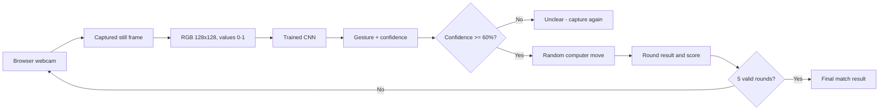
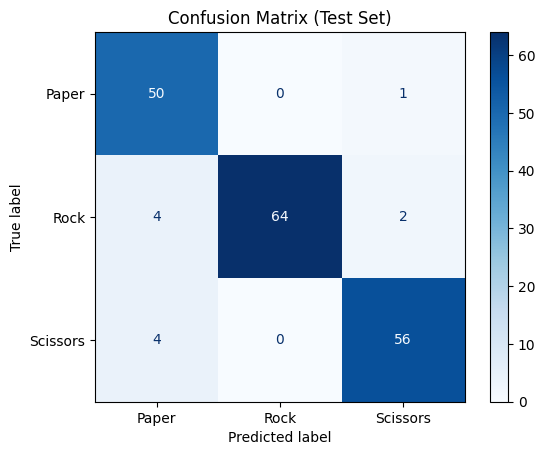
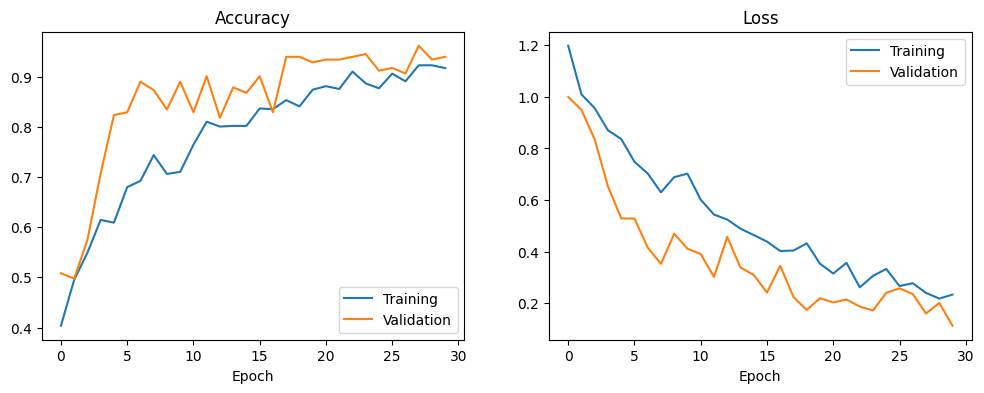
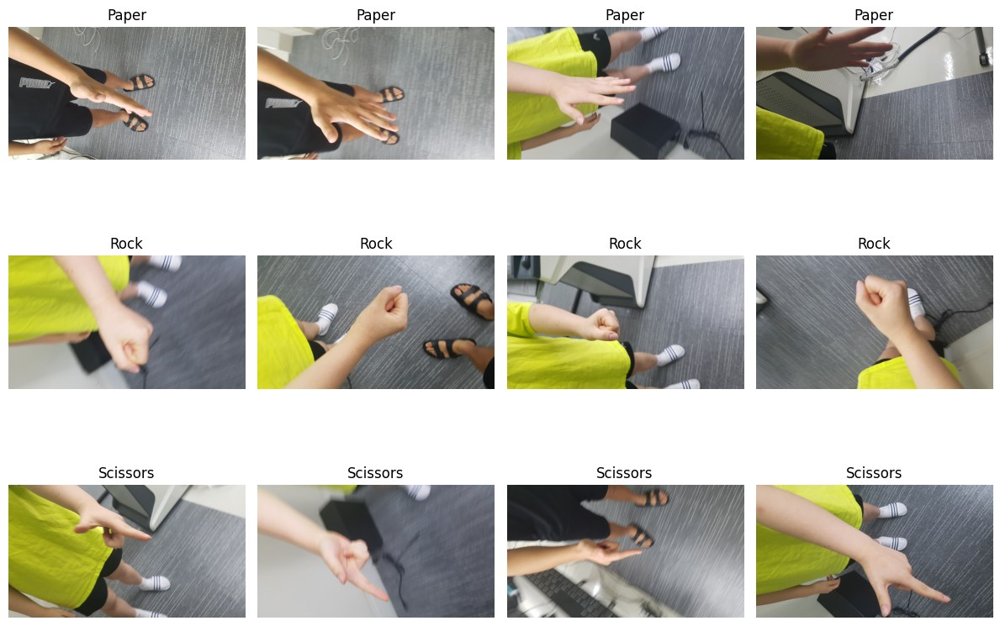
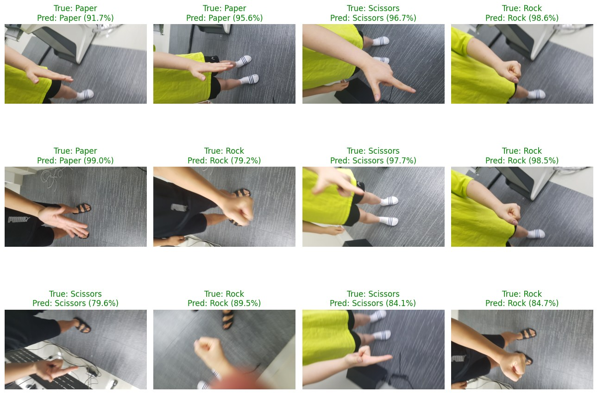

# Rock Paper Scissors — Live Webcam


[](https://www.kaggle.com/datasets/wlsgur4011/rock-siccors-paper)

A complete Rock Paper Scissors project: a convolutional neural network trained from scratch on 914 hand-gesture images, deployed as a **live browser-webcam game** with Gradio.

The notebook is designed for **Kaggle**, where `cv2.VideoCapture(0)` cannot open the user's camera. Gradio captures the webcam frame in the browser, sends it to the notebook kernel, and the trained CNN predicts the gesture.

**Notebook:** [`rock-paper-scissor-livecam-project.ipynb`](./rock-paper-scissor-livecam-project.ipynb)  
**Dataset:** [Kaggle — rock-siccors-paper](https://www.kaggle.com/datasets/wlsgur4011/rock-siccors-paper)  
**Author:** [Haseeb Ashraf](https://github.com/haseebashraf5656)

---

## Table of Contents

- [Overview](#overview)
- [Quick start](#quick-start)
- [Features](#features)
- [How it works](#how-it-works)
- [Dataset](#dataset)
- [Model](#model)
- [Results](#results)
- [Notebook structure](#notebook-structure)
- [Run on Kaggle](#run-on-kaggle-recommended)
- [Run locally](#run-locally)
- [Game settings](#game-settings)
- [Troubleshooting](#troubleshooting)
- [Project structure](#project-structure)
- [Requirements](#requirements)
- [Notes and credits](#notes-and-credits)

---

## Overview

The project has two parts:

1. **A from-scratch CNN** that classifies a hand image as **Paper**, **Rock**, or **Scissors**.
2. **A live webcam game** that captures a still frame in the browser, predicts the gesture with that CNN, and plays against a randomly chosen computer move.

The dataset, preprocessing, CNN architecture, training, and evaluation cells are the original working notebook cells. The game cell was upgraded from a command-line image-path game into a Gradio live webcam game. **The model and its preprocessing are unchanged.**

### Why Gradio?

Kaggle notebooks run on a remote server. `cv2.VideoCapture(0)` opens a camera on the Kaggle machine, not on the user's computer. Gradio solves this by running a small web app inside the notebook:

- The browser asks for webcam permission.
- The user captures a still frame in the browser.
- The frame is sent to the notebook kernel.
- The CNN predicts in the kernel, and the result is sent back to the page.

On Kaggle, Gradio creates a temporary `*.gradio.live` public link.

---

## Quick start

1. Upload `rock-paper-scissor-livecam-project.ipynb` to Kaggle.
2. Add the [Rock Paper Scissors dataset](https://www.kaggle.com/datasets/wlsgur4011/rock-siccors-paper) and turn **Internet on**.
3. Run cells 1 → 5, open the printed `gradio.live` link, allow the camera, and play.

Full instructions are in [Run on Kaggle](#run-on-kaggle-recommended).

---

## Features

- Live browser webcam with still-frame capture.
- Prediction from the trained CNN, with a confidence score.
- Random computer opponent.
- Standard Rock Paper Scissors rules.
- Score tracking across a 5-round match.
- Final match result and a rematch/reset button.
- Graceful handling of:
  - No captured frame.
  - Blank or uniform frames.
  - Prediction errors.
  - Low-confidence predictions (below 60%).
- Automatic Kaggle/local detection.
- Gradio 4+ support, including the Gradio 6 theme/CSS argument change.
- Automatic Gradio installation if it is missing.
- Clean, presentation-ready interface.

---

## How it works

1. Gradio asks the browser for camera access.
2. You show Rock, Paper, or Scissors and capture a still frame.
3. The frame is sent to the notebook kernel.
4. Preprocessing: RGB → 128×128 nearest-neighbor resize → float32 → divide by 255.
5. The existing CNN predicts a class and a confidence percentage.
6. If confidence is below 60%, the round does not count and you can capture again.
7. The computer chooses Paper, Rock, or Scissors uniformly at random.
8. Standard rules decide the round; the scores update.
9. After 5 valid rounds, the final match result is shown. The reset button starts a rematch.



---

## Dataset

**Source:** [rock-siccors-paper on Kaggle](https://www.kaggle.com/datasets/wlsgur4011/rock-siccors-paper)

| Class | Images |
|---|---:|
| Paper | 257 |
| Rock | 353 |
| Scissors | 304 |
| **Total** | **914** |

### The dataset is not included in this repository

The raw images are approximately **719 MB**. That is too large to commit to a normal GitHub repository, and the images belong to the original Kaggle dataset. Use the dataset link above instead.

Expected folder layout:

```text
rock_siccors_paper/
├── paper/
├── rock/
└── siccers/        # spelling as published on Kaggle
```

The notebook maps folder names by keyword (`rock`, `paper`, otherwise Scissors), so the `siccers` spelling is handled correctly.

### Dataset path

The notebook currently uses:

```python
BASE = '/kaggle/input/datasets/wlsgur4011/rock-siccors-paper/rock_siccers_paper'
```

Kaggle paths can differ depending on how the dataset is attached. If yours is different, copy the path from the **Data** panel in Kaggle and update `BASE` in cell 1. `BASE` must be the folder that directly contains `paper`, `rock`, and `siccers`.

For local runs, set `BASE` to your extracted dataset folder.

### Dataset license

Check the [dataset page](https://www.kaggle.com/datasets/wlsgur4011/rock-siccors-paper) for its license and terms. This repository does not redistribute the images.

---

## Model

The model is a small CNN built from scratch with Keras.

**Input:** `128 × 128 × 3` RGB image, `float32`, values in `[0, 1]`.

| Block | Layers | Output shape | Parameters |
|---|---|---|---|
| Input | — | `(128, 128, 3)` | — |
| Augmentation | `RandomFlip('horizontal')`, `RandomRotation(0.08)`, `RandomZoom(0.1)`, `RandomTranslation(0.1, 0.1)` | `(128, 128, 3)` | 0 |
| Conv block 1 | `Conv2D(32, 3, relu)` → `MaxPooling2D` | `(63, 63, 32)` | 896 |
| Conv block 2 | `Conv2D(64, 3, relu)` → `MaxPooling2D` | `(30, 30, 64)` | 18,496 |
| Conv block 3 | `Conv2D(128, 3, relu)` → `MaxPooling2D` | `(14, 14, 128)` | 73,856 |
| Classifier | `Flatten` → `Dense(128, relu)` → `Dropout(0.4)` | `(128)` | 3,211,392 |
| Output | `Dense(3, softmax)` | `(3)` | 387 |
| **Total** | | | **3,305,027 (12.61 MB)** |

**Compilation and training**

- Loss: `sparse_categorical_crossentropy`
- Optimizer: Adam, learning rate `0.001`
- Metric: accuracy
- Maximum epochs: 30
- Batch size: 32
- Early stopping: monitors `val_loss`, patience 5, restores the best weights
- Random seeds: `42` for Python, NumPy, and TensorFlow

**Classes and output order**

```python
class_names = ['Paper', 'Rock', 'Scissors']
```

Index `0 = Paper`, `1 = Rock`, `2 = Scissors`. This order must match the training labels.

**Preprocessing**

Both the dataset images and webcam frames use the same pipeline:

1. RGB, 3 channels.
2. Resize to `128 × 128` with nearest-neighbor interpolation (matching `keras.utils.load_img` defaults).
3. Convert with `keras.utils.img_to_array`.
4. Divide by `255.0`.
5. Feed a `float32` array of shape `(1, 128, 128, 3)`.

**Saved model**

Cell 3 saves the trained model to:

```python
/kaggle/working/rps_dnn_model.keras
```

The game reuses the in-memory model and does not retrain. The `.keras` file is ignored by `.gitignore` because it is a generated artifact.

---

## Results

### Data split

| Split | Images |
|---|---:|
| Total dataset | 914 |
| Held out for Task 6 (4 per class) | 12 |
| Remaining data | 902 |
| Training | 721 |
| Testing | 181 |

The 12 held-out images are never used for training or testing.

### Metrics from the committed run

| Metric | Value |
|---|---:|
| Training accuracy | 96.39% |
| Test accuracy | **93.92%** |
| Peak validation accuracy during training | 96.13% |
| Task 6 held-out images correct | **12 / 12** |

### Classification report (test set)

| Class | Precision | Recall | F1-score | Support |
|---|---:|---:|---:|---:|
| Paper | 0.86 | 0.98 | 0.92 | 51 |
| Rock | 1.00 | 0.91 | 0.96 | 70 |
| Scissors | 0.95 | 0.93 | 0.94 | 60 |
| **Accuracy** | | | **0.94** | **181** |
| Macro average | 0.94 | 0.94 | 0.94 | 181 |
| Weighted average | 0.94 | 0.94 | 0.94 | 181 |

### Confusion matrix



Rows are the true labels and columns are the predicted labels.

### Training curves



### Dataset samples



### Task 6 held-out predictions



All 12 held-out images were classified correctly.

> Results can vary slightly on a rerun because of random data augmentation, weight initialization, and hardware nondeterminism. The seeds are set to 42, but GPU operations are not always bit-for-bit reproducible.

---

## Notebook structure

The notebook contains eight cells:

| Cell | Name | What it does |
|---:|---|---|
| 0 | Kaggle environment check | Prints the `/kaggle` directories and locates the dataset folders. Optional. |
| 1 | Imports and data discovery | Imports TensorFlow/Keras, defines `class_names`, finds the three class folders, counts images, and displays samples. |
| 2 | Preprocessing | Defines `IMG_SIZE = 128` and `load_image`, holds out 12 images for Task 6, loads the arrays, and makes an 80/20 train/test split. |
| 3 | CNN and training | Defines the CNN, compiles it, trains for up to 30 epochs with early stopping, and saves the model. |
| 4 | Evaluation | Prints training/test accuracy, plots training curves, and shows the confusion matrix and classification report. |
| 5 | **Live webcam game** | The upgraded Gradio game: webcam, capture, prediction, scores, rounds, and final result. |
| 6 | Task 6 evaluation | Predicts the 12 held-out images and displays each result with confidence. |
| 7 | Stop server | Calls `gr.close_all()` to stop the Gradio server. |

**Only the game cell was replaced.** The dataset, preprocessing, CNN, training, and evaluation cells remain the original working versions.

> The game cell is cell index 5 in the notebook (the sixth cell). It reuses `model`, `class_names`, `load_image`, `IMG_SIZE`, and `keras` from the cells above.

---

## Run on Kaggle (recommended)

1. Create a new Kaggle notebook and upload `rock-paper-scissor-livecam-project.ipynb`.
   - Kaggle: **File → Import Notebook → Upload**.
2. Add the dataset:
   - **Add Input** → search **rock-siccors-paper** by `wlsgur4011` → attach it.
   - Or open the [dataset page](https://www.kaggle.com/datasets/wlsgur4011/rock-siccors-paper) and click **New Notebook**.
3. In **Session options**:
   - Set **Internet: On**. This is required for Gradio, the public tunnel, and the auto-install.
   - Optionally set **Accelerator: GPU** to make training faster.
4. Check `BASE` in cell 1. Use the path shown in the **Data** panel. The committed value is:
   ```python
   BASE = '/kaggle/input/datasets/wlsgur4011/rock-siccors-paper/rock_siccers_paper'
   ```
5. Run cells 1, 2, 3, and 4 in order. Wait for training and evaluation to finish.
6. Run cell 5. Wait for output like:
   ```text
   * Running on public URL: https://xxxxxxxx.gradio.live
   ```
7. Open the `gradio.live` link in a new browser tab. Chrome or Edge is recommended.
8. Allow camera access. Show a gesture, click the camera button in the webcam panel to capture a still frame, then press **Play Round**.
9. Play 5 valid rounds. The final result appears after round 5. Use **Play Again / Reset Match** for a rematch.
10. Run cell 7 when finished to close the Gradio server.

**Important:** a Kaggle restart clears all variables. The game cell does not train or load a model by itself. After a restart, run cells 1–3 again (or load a saved model) before running cell 5.

---

## Run locally

The notebook is preconfigured for Kaggle paths. To run it on your computer:

1. Clone the repository and create a virtual environment:
   ```bash
   git clone https://github.com/haseebashraf5656/Rock-Paper-Scissor-WebCam.git
   cd Rock-Paper-Scissor-WebCam
   python -m venv .venv
   ```

   Windows:
   ```bash
   .venv\Scripts\activate
   ```

   macOS/Linux:
   ```bash
   source .venv/bin/activate
   ```

   Install the dependencies:
   ```bash
   pip install -r requirements.txt
   ```

2. Download the dataset from [Kaggle](https://www.kaggle.com/datasets/wlsgur4011/rock-siccors-paper) and extract it.

3. Start Jupyter:
   ```bash
   jupyter notebook rock-paper-scissor-livecam-project.ipynb
   ```

4. In **cell 1**, change `BASE` to your local dataset folder:
   ```python
   BASE = r"C:\path\to\rock_siccors_paper"
   ```

   `BASE` must directly contain the `paper`, `rock`, and `siccers` folders.

5. In **cell 3**, change the save path:
   ```python
   model.save('rps_dnn_model.keras')
   ```

   `/kaggle/working` does not exist on a normal local machine.

6. Run cells 1 → 5. The game cell opens a local browser tab. No public link is needed locally.

7. Allow camera access and play. Browser webcams work on `localhost`, which is treated as a secure context.

8. Run cell 7 to stop the server.

### Python and TensorFlow locally

TensorFlow support depends on the Python version. If `pip install tensorflow` fails on Python 3.13, create the virtual environment with Python 3.11 or 3.12. On Kaggle, the environment is already configured and no manual TensorFlow install is needed.

---

## Game settings

The main settings are at the top of cell 5:

| Setting | Default | Meaning |
|---|---:|---|
| `TOTAL_ROUNDS` | `5` | Number of valid rounds in a match |
| `CONFIDENCE_THRESHOLD` | `60.0` | Predictions below this percentage do not count |
| `IMG_SIZE` | `128` | Must match the model input size |
| `class_names` | `['Paper', 'Rock', 'Scissors']` | Must match the training label order |

Game behavior:

- The computer's move is uniformly random.
- Scores only change on valid rounds.
- A draw counts as a played round but does not change either score.
- After 5 valid rounds, further **Play Round** presses show `MATCH ALREADY FINISHED` until the match is reset.
- **Play Again / Reset Match** clears the webcam, captured frame, result, confidence, scores, and round count.
- Blank frames are detected with a pixel standard deviation below `4.0`.
- If the model raises an error, the game shows `PREDICTION FAILED` instead of crashing.

---

## Troubleshooting

### `RuntimeError: Missing: model, class_names, load_image, IMG_SIZE, keras`

The kernel was restarted and the game cell was run without the setup/training cells. Run cells 1–3 first.

To avoid retraining after a restart, save `rps_dnn_model.keras` to a Kaggle Dataset or download it, then load it in a new session:

```python
from tensorflow import keras

class_names = ['Paper', 'Rock', 'Scissors']
IMG_SIZE = 128

def load_image(path):
    img = keras.utils.load_img(path, target_size=(IMG_SIZE, IMG_SIZE))
    return keras.utils.img_to_array(img) / 255.0

model = keras.models.load_model('/kaggle/working/rps_dnn_model.keras')
```

Then run the game cell.

### No public URL, or `Could not create share link. Missing file: .../frpc_linux_amd64_v0.3`

Kaggle Internet is off, or the Gradio tunnel binary could not be downloaded.

1. Turn **Internet: On** in **Session options**.
   - If the toggle is unavailable, verify your phone number in Kaggle account settings.
2. Re-run the game cell.
3. If it still fails, run this in a new cell:
   ```python
   !mkdir -p /root/.cache/huggingface/gradio/frpc
   !wget -q -O /root/.cache/huggingface/gradio/frpc/frpc_linux_amd64_v0.3 https://cdn-media.huggingface.co/frpc-gradio-0.3/frpc_linux_amd64
   !chmod +x /root/.cache/huggingface/gradio/frpc/frpc_linux_amd64_v0.3
   !ls -lh /root/.cache/huggingface/gradio/frpc/
   ```
4. Re-run the game cell.

### How to stop the public URL

The public URL is tied to the Gradio server in the kernel. Stop it with:

```python
demo.close()
```

or:

```python
import gradio as gr
gr.close_all()
```

Stopping or restarting the Kaggle session also kills the server and the link. Re-running the game cell closes the old server and prints a new URL.

### The webcam does not appear

- Open the `gradio.live` link in a new browser tab, not inside a restricted iframe.
- Use Chrome or Edge.
- Allow camera permission for the site; check the camera icon in the address bar.
- Close other applications that may be using the camera.
- Camera access requires HTTPS or `localhost`. The `gradio.live` link uses HTTPS; a local Gradio app uses `localhost`.

### Predictions are wrong or confidence is low

- Fill most of the frame with your hand.
- Use a plain background and good lighting.
- Keep the gesture style similar to the dataset.
- The dataset contains phone photos of hands; very different lighting or backgrounds can reduce accuracy.
- The 60% threshold is intentional. Lower it only if you understand the trade-off.

### `model.save` fails locally

`/kaggle/working` exists only on Kaggle. Change the save path in cell 3:

```python
model.save('rps_dnn_model.keras')
```

### The Kaggle session restarted and `/kaggle/working` is empty

Kaggle's working directory is temporary. Retrain the model, or keep a copy of `rps_dnn_model.keras` in a Kaggle Dataset or download it. Downloading the `.keras` file after training is the simplest backup.

### Dataset path not found

Update `BASE` in cell 1 to the exact path shown in Kaggle's **Data** panel. The path may not contain the same `/datasets/` segment as the committed value. The folder must directly contain `paper`, `rock`, and `siccers`.

### Gradio version issues

The cell targets Gradio 4+ and is tested with Gradio 6.30.0. If you have an old version, upgrade:

```bash
pip install -U "gradio>=4"
```

On Kaggle, the game cell installs Gradio automatically if it is missing.

---

## Project structure

```text
Rock-Paper-Scissor-WebCam/
├── rock-paper-scissor-livecam-project.ipynb
├── README.md
├── requirements.txt
├── .gitignore
└── assets/
    ├── dataset_samples.jpg
    ├── training_history.png
    ├── confusion_matrix.png
    └── task6_predictions.jpg
```

The dataset and the trained `.keras` model are not committed. See [Dataset](#dataset) for the dataset link.

---

## Requirements

- Python 3.10+ (3.11 or 3.12 is a safe choice for local TensorFlow installs)
- TensorFlow 2.16+ / Keras 3
- Gradio 4+ (tested with Gradio 6.30.0)
- NumPy
- Pillow
- Matplotlib
- scikit-learn
- Jupyter

Install everything with:

```bash
pip install -r requirements.txt
```

On Kaggle, TensorFlow, NumPy, Matplotlib, and scikit-learn are preinstalled. The game cell installs Gradio if it is missing.

---

## Notes and credits

- The project originated as an ANN lab notebook and was extended into a complete live webcam demo.
- The original dataset, preprocessing, CNN, training, and evaluation cells were kept unchanged. The game cell is the upgraded part.
- The public `gradio.live` URL is temporary and is not stored in this repository. The game cell prints a fresh URL each time it runs.
- The webcam frame is processed inside the notebook kernel. While the app is running, anyone with the public link can open it. Stop the server with cell 7 when finished.
- Dataset credit: [wlsgur4011/rock-siccors-paper](https://www.kaggle.com/datasets/wlsgur4011/rock-siccors-paper) on Kaggle.
- No license file is included for the code. The dataset remains under its original Kaggle license and terms.
